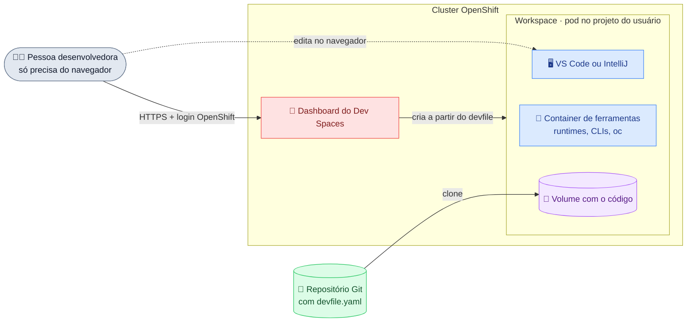

# Manual de OpenShift Dev Spaces

**Ambientes de desenvolvimento na nuvem, prontos em minutos e acessados pelo navegador.**
O Red Hat OpenShift Dev Spaces, baseado no projeto open source [Eclipse Che](https://eclipse.dev/che/),
cria um *workspace* (editor, ferramentas, runtimes e código) dentro do cluster OpenShift.

[Começar o onboarding →](onboarding/trilha.md){ .md-button .md-button--primary }
[Criar meu primeiro workspace](onboarding/primeiros-30-minutos.md){ .md-button }

*Figura 1 · O dashboard cria o workspace a partir do `devfile.yaml` do repositório; a pessoa usa o editor no navegador.*

## Por que usar

-   ⚡ __Onboarding em minutos__

    ---

    Um link abre o ambiente pronto. Nada para instalar na máquina.

-   📄 __Ambiente como código__

    ---

    O `devfile.yaml` no repositório define ferramentas, comandos e portas. Todos usam o mesmo ambiente.

-   🔒 __Código dentro da rede__

    ---

    O código não sai do cluster. Login pelo OpenShift (OAuth, LDAP/AD), com RBAC e quotas.

-   🧩 __Editores conhecidos__

    ---

    VS Code (build open source) ou JetBrains IntelliJ IDEA, no navegador.

## Por onde começar

| Você é | Comece por |
|--------|-----------|
| Pessoa desenvolvedora | [Trilha de onboarding](onboarding/trilha.md) |
| Tech lead preparando um repositório | [Devfile](uso/devfile.md) |
| Admin da plataforma | [Instalação](administracao/instalacao.md) |

!!! tip "Sem cluster? Teste grátis"
    O [Developer Sandbox da Red Hat](https://developers.redhat.com/developer-sandbox) inclui o
    Dev Spaces e não tem custo.

**Referências:** [Página do produto](https://developers.redhat.com/products/openshift-dev-spaces) ·
[Documentação oficial](https://docs.redhat.com/en/documentation/red_hat_openshift_dev_spaces/latest)
