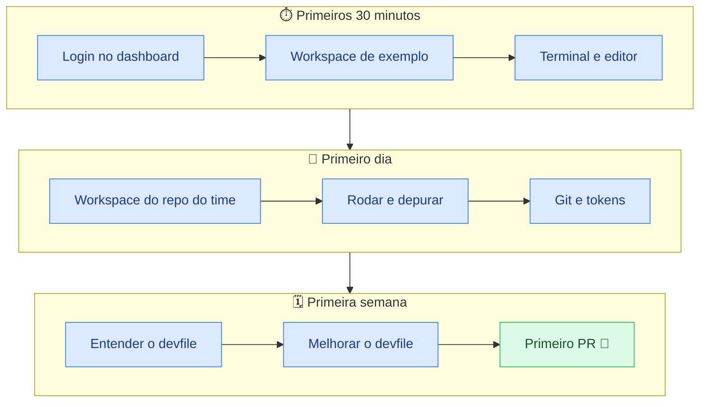

# Trilha de onboarding

!!! abstract "Em uma frase"
    Em **30 minutos** você abre o primeiro workspace; no **primeiro dia** trabalha num repositório
    do time; na **primeira semana** entrega um PR feito inteiramente no Dev Spaces.

*Figura 2 · A jornada de onboarding em três etapas, do primeiro login ao primeiro PR.*

| Etapa | Objetivo | Guia | Checklist |
|-------|----------|------|-----------|
| ⏱️ 30 minutos | Primeiro workspace aberto | [Primeiros 30 minutos](primeiros-30-minutos.md) | 4 itens |
| 📅 Dia 1 | Trabalhando no repositório do time | [Primeiro dia](primeiro-dia.md) | 6 itens |
| 🗓️ Semana 1 | Autonomia: PR entregue, devfile entendido | [Primeira semana](primeira-semana.md) | 5 itens |

## Antes de começar

- [ ] Você tem login no cluster OpenShift (o mesmo das outras ferramentas).
- [ ] Sabe a URL do Dev Spaces da organização, por exemplo `https://devspaces.apps.<cluster>`.
- [ ] Tem acesso de leitura ao repositório do time no Git.

!!! info "Quem ajuda"
    Dúvidas de uso: seu buddy de onboarding. Problemas na plataforma: `platform-team`.
    Veja também o [Onboarding de TI](http://localhost:3000/docs/default/component/onboarding-ti).
