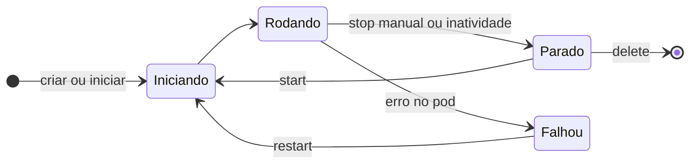

# Workspaces

Um workspace é um **pod** no seu projeto do OpenShift, com o editor, os containers de ferramentas
do devfile e um volume persistente com o código.

*Figura 3 · Ciclo de vida de um workspace. Parado não consome CPU nem memória; o volume continua.*

| Ação | Como |
|------|------|
| Criar a partir de um repositório | Factory URL `https://<dev-spaces>/#<url-do-repo>` |
| Listar, parar, apagar | Dashboard → **Workspaces** |
| Reiniciar a partir do devfile | Paleta de comandos → **Dev Spaces: Restart Workspace from Local Devfile** |
| Ver logs do pod | Dashboard → workspace → **Logs** |

!!! warning "Inatividade"
    Workspaces sem uso são parados automaticamente após o tempo configurado pela plataforma.
    Salve e faça commit com frequência.
